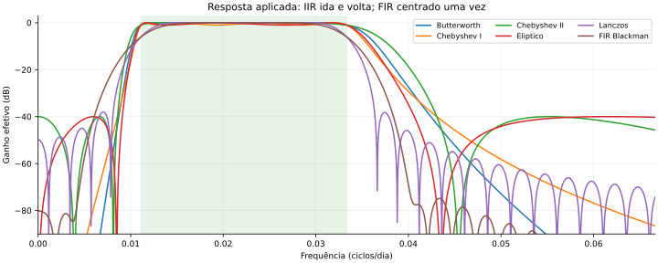

# Laboratório didático de filtragem passa-banda

Como escolher, aplicar e avaliar filtros digitais em séries climáticas? Este módulo permite estudar **Butterworth, Chebyshev I, Chebyshev II, Elíptico, Lanczos e FIR Blackman**, usando a mesma série sintética e conhecendo previamente o sinal que se deseja recuperar.

A banda **30–90 dias é um exemplo configurável**, não uma definição universal da variabilidade intrassazonal nem uma reprodução automática da metodologia MIRISA. Para outra aplicação, define os períodos com base no fenômeno e no método adotado.

## Sequência de estudo

| Etapa | Material | O que aprender |
| --- | --- | --- |
| 1 | [Fundamentos](docs/01_fundamentos.md) | Período, frequência, Nyquist, ganho e fase |
| 2 | [Guia dos seis filtros](docs/02_filtros.md) | Diferenças entre famílias e parâmetros |
| 3 | [Experimento e comparação](docs/03_experimento.md) | Executar, ler gráficos e interpretar métricas |
| 4 | [Aplicação climática](docs/04_aplicacao_climatica.md) | Anomalias, lacunas, bordas e previsão |
| 5 | [Exercícios](docs/05_exercicios.md) | Alterar bandas, janelas e avaliar sensibilidade |
| 6 | [Referências](docs/06_referencias.md) | Fontes e documentação das implementações |

## Executar o exemplo

Requer Python 3.11 ou superior. O ambiente de referência executado está registrado em [execucao.json](resultados/referencia/execucao.json).

```bash
# Na raiz do repositório MIRISA:
python -m venv .venv
# Linux/macOS:
source .venv/bin/activate
# Windows PowerShell: .venv\Scripts\Activate.ps1
python -m pip install -r FILTRAGEM_PASSA_BANDA/requirements.txt
python FILTRAGEM_PASSA_BANDA/scripts/comparar_filtros.py
```

Abre os arquivos SVG em `FILTRAGEM_PASSA_BANDA/resultados/local/` no navegador. As saídas incluem séries, resposta em frequência, espectros, bordas/fase, métricas CSV e parâmetros/versões JSON. O programa não baixa dados e pode ser executado de qualquer diretório: os caminhos padrão são relativos ao próprio script.

Edita [parametros.json](exemplos/parametros.json) para trocar a banda, a amostragem, a janela FIR ou as especificações IIR. Para guardar outro experimento:

```bash
python FILTRAGEM_PASSA_BANDA/scripts/comparar_filtros.py --config FILTRAGEM_PASSA_BANDA/exemplos/parametros.json --saida FILTRAGEM_PASSA_BANDA/resultados/local/experimento_02
```

Para executar as verificações numéricas:

```bash
python FILTRAGEM_PASSA_BANDA/scripts/verificar_filtros.py
```

## Comparações já geradas



[Comparação temporal](resultados/referencia/series.svg) · [Espectros](resultados/referencia/espectros.svg) · [Bordas e fase](resultados/referencia/bordas_fase.svg) · [Métricas](resultados/referencia/metricas.csv)

**Como interpretar:** IIR foram projetados para as mesmas exigências efetivas de passagem/rejeição; FIR usam 401 coeficientes e não estão ajustados às mesmas tolerâncias. Não uses esta comparação para declarar um vencedor universal.

## Organização

| Caminho | Conteúdo |
| --- | --- |
| `docs/` | Sequência didática e fichas dos filtros |
| `scripts/` | Implementação executável em Python/SciPy |
| `exemplos/` | Parâmetros editáveis |
| `resultados/referencia/` | Figuras, métricas e metadados da execução de referência |
| `resultados/local/` | Resultados gerados localmente; ignorados pelo Git |
| `legado/original/` | Cópia integral do material anterior, incluindo exemplos em R e imagens |
| [MIGRACAO.md](MIGRACAO.md) | Destinos e correções da reorganização |

Os exemplos novos foram implementados em Python para permitir uma execução única e verificável dos seis métodos. Os exemplos anteriores em R estão preservados no legado e não foram validados numericamente nesta revisão.

## Licença e autoria

Aplica-se a [GPLv3 do repositório](../LICENSE). A reorganização e os novos exemplos foram realizados em 16/10/2026. Mantêm-se os avisos de autoria e agradecimentos do projeto. Este laboratório não altera as rotinas de produção em `INDEX_MIRISA`.
