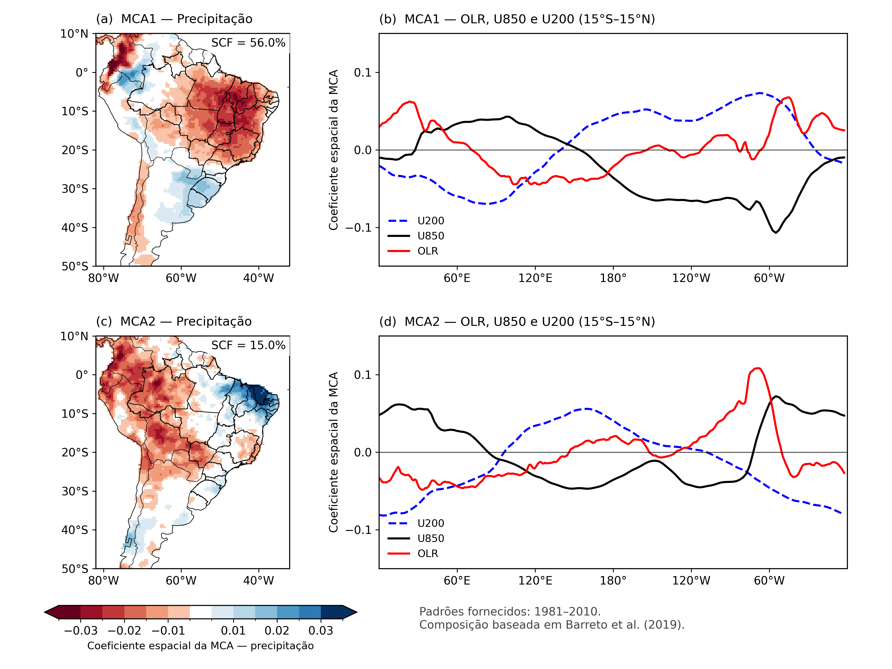
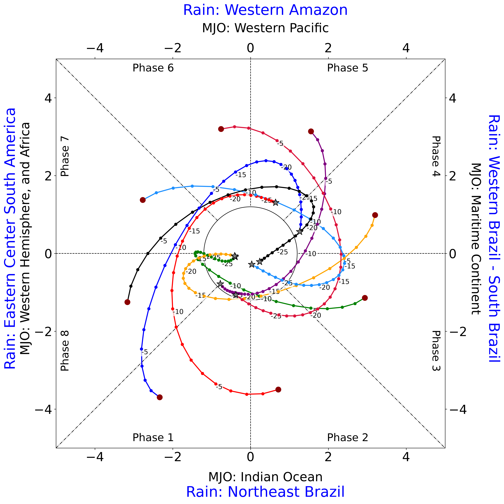
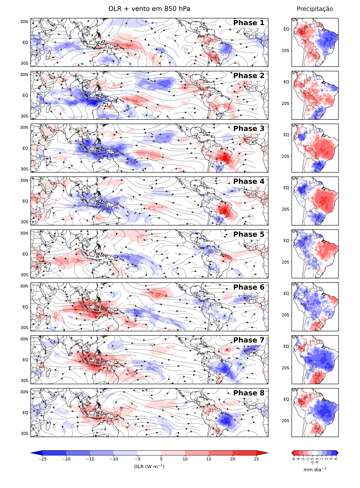

<div align="center">

  <h1>MIRISA</h1>

  <h3>Índice Multivariado Intrassazonal de Precipitação da América do Sul</h3>

  <p>
    Precipitação, convecção e circulação tropical:
    uma perspectiva integrada da variabilidade intrassazonal.
  </p>

  <p>
    <a href="#sobre-o-mirisa">Sobre o MIRISA</a> •
    <a href="#motivação-e-problema-científico">Motivação</a> •
    <a href="#a-ideia-do-índice">Metodologia</a> •
    <a href="#perspectivas">Perspectivas</a> •
    <a href="#estrutura">Estrutura</a> •
    <a href="INDEX_MIRISA/README.md">Documentação</a>
  </p>

  <p>
    <a href="https://doi.org/10.1002/met.1780">
      
    </a>
    <a href="LICENSE">
      
    </a>
    
  </p>

</div>
<p align="center">
O desenvolvimento deste projeto contou com apoio financeiro da <strong>CAPES</strong> e do
  <strong>CNPq</strong>, por meio da concessão de bolsas de doutorado e pós-doutorado, respectivamente (processo CNPq nº 153540/2016-8).
</p>

## Sobre o MIRISA

O **MIRISA — Índice Multivariado Intrassazonal de Precipitação da América do Sul** foi desenvolvido para representar a evolução das anomalias de chuva no continente e sua associação com a convecção e a circulação atmosférica tropical. Sua proposta é incorporar diretamente a precipitação regional à construção de um índice que permita acompanhar a **fase e a amplitude da variabilidade intrassazonal**.

### Motivação e problema científico

Uma estação chuvosa pode apresentar um total próximo da média e, ainda assim, concentrar a precipitação em poucos episódios, intercalados por períodos prolongados de pouca chuva. Essa distribuição temporal importa para a disponibilidade hídrica, a agricultura, a geração de energia e a ocorrência de desastres.

Compreender essas alternâncias exige investigar os processos que organizam a chuva em escalas de semanas a poucos meses. Entre eles, destaca-se a Oscilação Madden–Julian (MJO), cuja evolução pode influenciar a convecção e a circulação sobre a América do Sul. Entretanto, a resposta regional depende da localização, da época do ano e da configuração atmosférica.

**Como representar a variabilidade intrassazonal de grande escala mantendo a precipitação sul-americana no centro da análise?** Essa pergunta orienta o desenvolvimento do MIRISA.

### A ideia do índice

O MIRISA utiliza a **Análise de Máxima Covariância (MCA)** para identificar padrões de variabilidade conjunta entre dois conjuntos de dados: a precipitação sobre a América do Sul e os campos tropicais de radiação de onda longa emergente (OLR) e vento zonal em 850 e 200 hPa.

Na formulação publicada, as anomalias diárias são filtradas na banda de **20–100 dias**. As séries temporais dos dois primeiros modos da MCA são combinadas para construir duas componentes do índice, representadas em um diagrama com oito fases.

A fase situa o estado do índice nesse espaço, enquanto a amplitude expressa sua distância à origem. As composições permitem examinar os padrões de precipitação, convecção e circulação associados a cada fase. Uma amplitude elevada indica maior expressão do sinal representado pelo índice; sua relação com chuva intensa ou deficiência de precipitação depende da região e precisa ser avaliada.

### Por que utilizar o MIRISA?

Seu diferencial é estabelecer uma ligação estatística explícita entre **a chuva regional e a configuração atmosférica tropical**. Isso permite investigar como padrões de precipitação se organizam e evoluem durante o ciclo intrassazonal, incluindo situações com anomalias de sinais opostos em diferentes setores do continente.

O índice oferece, assim, uma referência para estudar a persistência e as transições desses padrões, sua relação com a MJO e sua associação com períodos de intensificação e enfraquecimento das chuvas.

### Perspectivas

As próximas etapas de pesquisa incluem avaliar a relação entre fases e amplitudes do MIRISA e a ocorrência de períodos ativos e inativos da monção sul-americana, considerando duração, intensidade e defasagem temporal. Também interessa investigar a estabilidade dos padrões diante de diferentes bases de dados e períodos climatológicos.

Outra perspectiva é avaliar sua contribuição para o monitoramento e a previsão subsazonal. Essa aplicação requer verificar o desempenho com dados disponíveis na data de emissão, o tratamento das bordas da filtragem e a capacidade de antecipar condições regionais.

Este repositório reúne as rotinas e a documentação necessárias para tornar essas análises reproduzíveis e apoiar o desenvolvimento científico do MIRISA.

### Referência principal

Barreto et al. (2019). **Multivariate intraseasonal rainfall index applied to South America**. *Meteorological Applications*, 26, 521–527. [https://doi.org/10.1002/met.1780](https://doi.org/10.1002/met.1780).

# 
## MIRISA — referência climatológica 1991–2020

Os produtos abaixo apresentam os padrões espaciais da MCA associados à referência de 1991–2020 e ilustram a representação do MIRISA em oito fases. O período climatológico, o período de ajuste e a amostra usada em cada composição devem ser identificados separadamente.

### Padrões espaciais da MCA

Os dois primeiros modos representam, respectivamente, **56% e 15% da covariância quadrática total**, somando **71%**, conforme a [tabela de frações de covariância](INDEX_MIRISA/outputs/tables/mca_mirisa_fracao_covariancia_quadratica_1991-2020.txt). Esses percentuais não correspondem à variância explicada da precipitação isoladamente.

[](INDEX_MIRISA/outputs/figures/MIRISA_MCA_1991_2020.png)

**Figura 1.** Padrões espaciais de precipitação na América do Sul (painéis a e c) e perfis longitudinais de OLR e vento zonal em 850 e 200 hPa na faixa de 15°S–15°N (painéis b e d), para os dois primeiros modos da MCA. As cores dos mapas representam os coeficientes espaciais da precipitação.

> **Identificação do período:** o nome do PNG e as entradas registradas em [parametros_figura1.json](INDEX_MIRISA/outputs/figures/parametros_figura1.json) indicam 1991–2020, mas o rodapé da imagem informa 1981–2010. Essa divergência deve ser resolvida na rotina de origem e a figura regenerada antes de sua utilização como versão definitiva.


### Evolução no espaço de fases
As trajetórias representam a evolução das composições do MIRISA associadas às oito fases, no espaço definido por suas duas primeiras componentes. As defasagens negativas indicam os dias anteriores ao dia de referência (lag 0), permitindo acompanhar a evolução da fase e da amplitude do índice. A distância à origem expressa a amplitude, e o círculo central delimita o valor 1. Os rótulos externos indicam as regiões de precipitação associadas ao MIRISA e a localização da convecção associada à Oscilação Madden–Julian (MJO).


<p align="center">
  <a href="INDEX_MIRISA/outputs/figures/MIRISA_COMPOSITE_DIAG_T1.png">
    
  </a>
</p>

**Figura 2.** Evolução das composições do MIRISA no espaço definido por suas duas primeiras componentes. As curvas coloridas representam trajetórias associadas às oito fases, com pontos em intervalos diários e números indicando defasagens em dias em relação ao dia de referência (lag 0); valores negativos correspondem aos dias anteriores. A distância à origem expressa a amplitude do índice, e o círculo central delimita amplitude igual a 1. As linhas dividem o espaço em oito setores de fase. Os rótulos externos indicam as regiões de precipitação associadas ao MIRISA (azul) e a localização da convecção associada à Oscilação Madden–Julian — MJO (preto).


### Composições das oito fases

[](INDEX_MIRISA/outputs/figures/COMPOSICAO_MIRISA_python.png)

**Figura 3.** Composições associadas às oito fases do MIRISA. À esquerda, anomalias de OLR (W m⁻²) e linhas de corrente em 850 hPa; à direita, anomalias de precipitação na América do Sul (mm dia⁻¹). Na escala de OLR, azul indica anomalias negativas e vermelho, positivas; na precipitação, azul indica anomalias positivas e vermelho, negativas.

**Amostra da composição:** a imagem não informa o período, os meses selecionados, o limiar de amplitude ou eventual teste de significância. Esses critérios precisam ser confirmados na execução que produziu o PNG; por isso, esta composição é apresentada como ilustração das fases, sem atribuição definitiva à referência de 1991–2020. Clica na imagem para consultar os painéis em tamanho original.

### Estrutura

Rotinas científicas para preparar dados, ajustar a **análise de máxima covariância (MCA)**, calcular e projetar o índice MIRISA e analisar suas fases e amplitudes na América do Sul.

O repositório reúne processamento de precipitação, radiação de onda longa emergente (OLR) e circulação atmosférica, além de composições, diagramas de fase e análises de períodos ativos e inativos da monção sul-americana.

**Branch principal:** `main`  
**Estado:** estrutura organizada; implementação científica e execução completa ainda em validação.

[Documentação do índice](INDEX_MIRISA/README.md) · [Organização dos dados](INDEX_MIRISA/data/README.md) · [Migração de arquivos](INDEX_MIRISA/MIGRACAO.md) · [Avaliação técnica](INDEX_MIRISA/AVALIACAO_TECNICA.md)


## O que encontras aqui

| Diretório | Conteúdo |
| --- | --- |
| [INDEX_MIRISA](INDEX_MIRISA/README.md) | Cálculo, projeção e análise do MIRISA |
| [INDEX_MIRISA/config](INDEX_MIRISA/config/README.md) | Caminhos de execução e períodos climatológicos |
| [INDEX_MIRISA/scripts/preprocess](INDEX_MIRISA/scripts/preprocess/README.md) | Climatologias, anomalias, filtros e padronização |
| [INDEX_MIRISA/scripts/index](INDEX_MIRISA/scripts/index/README.md) | Ajuste MCA e projeção nos padrões de referência |
| [INDEX_MIRISA/scripts/analysis](INDEX_MIRISA/scripts/analysis/README.md) | Composições, diagnósticos e análise da monção |
| [INDEX_MIRISA/scripts/plots](INDEX_MIRISA/scripts/plots/README.md) | Mapas e diagramas de fase |
| [INDEX_MIRISA/scripts/functions](INDEX_MIRISA/scripts/functions/README.md) | Funções compartilhadas em R, Python e GrADS |
| [INDEX_MIRISA/experiments](INDEX_MIRISA/experiments/README.md) | Versões históricas e protótipos |
| [INDEX_MIRISA/data](INDEX_MIRISA/data/README.md) | Estrutura para dados locais por variável e tratamento |
| [INDEX_MIRISA/outputs](INDEX_MIRISA/outputs/README.md) | Destinos de modelos, tabelas, NetCDF e figuras |
| [FILTRAGEM_PASSA_BANDA](FILTRAGEM_PASSA_BANDA/README.md) | Documentação e exemplos de filtros digitais |

## Começar

Clona a branch principal em uma pasta nova:

```bash
git clone --branch main --single-branch https://github.com/netebarreto/MIRISA.git
cd MIRISA/INDEX_MIRISA
```

As rotinas devem ser executadas a partir de `INDEX_MIRISA`. Para indicar outra localização, define `MIRISA_ROOT` com o caminho absoluto dessa pasta.

Antes de executar, consulta o README da etapa, instala as dependências e fornece os arquivos de entrada. **O clone não inclui os NetCDF volumosos, os modelos ajustados nem as séries do índice disponíveis apenas na máquina local.** O [mapa de migração](INDEX_MIRISA/MIGRACAO.md) indica os destinos dos arquivos anteriores.

## Download das variáveis

Links de referência para localizar os dados usados nas rotinas:

| Variável | Fonte | Endereço |
| --- | --- | --- |
| Vento zonal — U-wind (`uwnd`) | NCEP/NCAR Reanalysis — dados diários em níveis de pressão | [Diretório de download](https://downloads.psl.noaa.gov/Datasets/ncep.reanalysis/Dailies/pressure/) |
| Vento meridional — V-wind (`vwnd`) | NCEP/NCAR Reanalysis — dados diários em níveis de pressão | [Diretório de download](https://downloads.psl.noaa.gov/Datasets/ncep.reanalysis/Dailies/pressure/) |
| Precipitação — Rain CPC (`prec`), opção 1 | Página da base CPC Global Precipitation | [Descrição e acesso aos dados](https://psl.noaa.gov/data/gridded/data.cpc.globalprecip.html) |
| Precipitação — Rain CPC (`prec`), opção 2 | Diretório FTP CPC — GAUGE_GLB/RT | [Diretório de download via FTP](ftp://ftp.cpc.ncep.noaa.gov/precip/CPC_UNI_PRCP/GAUGE_GLB/RT/) |
| Radiação de onda longa emergente — OLR (`olr`) | NOAA/NCEI — dados diários | [Diretório de download](https://www.ncei.noaa.gov/data/outgoing-longwave-radiation-daily/access/) |

Após o download, organiza os arquivos conforme [data/README.md](INDEX_MIRISA/data/README.md).

## Organização dos dados

A hierarquia identifica variável, tratamento, fonte, versão/variante, nível, referência e método, quando aplicáveis:

```text
data/prec/anomalias/chirps/v3_final_rnl/1991_2020/
data/uwnd/climatologia/ncep/200hpa/1981_2010/
data/olr/filtrados/v01r02/1981_2020/butterworth_signal/
data/static/masks/
data/static/shapes/
```

As variáveis são `prec`, `uwnd`, `vwnd` e `olr`. Os tratamentos incluem `brutos`, `recortados`, `climatologia`, `anomalias`, `filtrados`, `desvio_padrao` e `padronizados`. Produtos antigos com referência mista ou pendente de confirmação ficam identificados como `historico`.

Pastas vazias são mantidas no Git por arquivos `.gitkeep`; sua existência não indica que os dados estejam disponíveis.

## Referências climatológicas

A configuração [climatology_periods.json](INDEX_MIRISA/config/climatology_periods.json) oferece:

| Identificador | Período inclusivo |
| --- | --- |
| `1981_2010` | 01/01/1981 a 31/12/2010 |
| `1991_2020` | 01/01/1991 a 31/12/2020 |
| `1981_2020` | 01/01/1981 a 31/12/2020 |

A rotina `scripts/preprocess/gerar_climatologias.sh` prepara médias diárias e anomalias para as referências selecionadas. O modo `standardize` recebe anomalias previamente filtradas e calcula o desvio de referência e a padronização. Consulta os [comandos e requisitos](INDEX_MIRISA/scripts/preprocess/README.md).

**Período climatológico, cobertura da série e período de ajuste MCA são escolhas distintas.** Preparar essas referências não reestima automaticamente os modelos MCA nem altera as datas dos scripts históricos.

## Fluxo de trabalho e dependências

Preparação dos dados → anomalias → filtragem intrassazonal → padronização → ajuste MCA → projeção → fases, amplitudes e diagnósticos.

- **Bash e CDO:** processamento NetCDF.
- **R:** ajuste MCA, filtragem e análises; pacotes como `ncdf4`, `fields`, `signal` e `seewave`, conforme a rotina.
- **Python:** climatologias, gráficos e notebooks; dependências específicas constam nos READMEs das etapas.
- **GrADS:** rotinas de mapas que utilizam essa ferramenta.

O projeto ainda não possui um ambiente único com todas as versões fixadas.

## Estado da implementação

A organização dos arquivos e as verificações de sintaxe/caminhos não equivalem à validação numérica do índice. Permanecem funções auxiliares ausentes, diferenças entre nomes de modelos salvos e carregados e questões de normalização, sinais e definição das componentes.

Filtros bilaterais usam informação posterior ao dia estimado; sua aplicação retrospectiva exige cuidados adicionais quando o objetivo é previsão. As pendências estão documentadas na [avaliação técnica](INDEX_MIRISA/AVALIACAO_TECNICA.md).

## Referência científica

Barreto et al. (2019). **Multivariate intraseasonal rainfall index applied to South America**. *Meteorological Applications*. [https://doi.org/10.1002/met.1780](https://doi.org/10.1002/met.1780).

Ao utilizar o método, cita o artigo e identifica a versão do código, as bases, os filtros e os períodos empregados. A correspondência entre cada rotina e a formulação publicada deve ser verificada.

## Licença

O código original deste projeto é disponibilizado sob a **GNU General Public License, versão 3 (GPLv3)** — identificador SPDX: `GPL-3.0-only`. Consulta o texto integral em [LICENSE](LICENSE).

A licença permite uso, modificação e redistribuição, inclusive comercial, sob suas condições. A distribuição de versões modificadas deve cumprir as obrigações de disponibilização do código-fonte e manutenção da licença. O software é fornecido sem garantia, nos termos da GPLv3.

Códigos de terceiros, bases de dados e publicações mantêm suas próprias licenças e avisos de autoria. O financiamento não substitui a identificação dos autores e titulares dos direitos.

## Agradecimentos

Parte do desenvolvimento deste projeto contou com apoio do **Conselho Nacional de Desenvolvimento Científico e Tecnológico (CNPq)**, por meio do **processo nº 153540/2016-8**.
